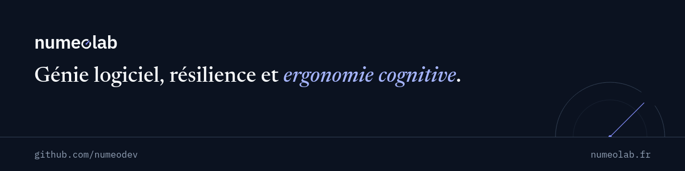

<p align="center">
  <a href="https://numeolab.fr">
    
  </a>
</p>

<p align="center">
  <a href="https://numeolab.fr"><strong>numeolab.fr</strong></a>
  ·
  <a href="https://numeolab.fr/blog/">Articles</a>
  ·
  <a href="https://numeolab.fr/projets/">Projets</a>
  ·
  <a href="https://numeolab.fr/rss.xml">Flux RSS</a>
</p>

<p align="center">
  <a href="https://github.com/numeodev/numeolab_le_blog/actions/workflows/ci.yml"></a>
  
  
  
  
</p>

---

**Numeolab** est le blog technique de Mathurin Bourgouin, développeur full stack .NET. On y trouve des analyses, des retours d'expérience et des notes de lecture sur la conception de systèmes logiciels fiables, et sur ce que les agents IA changent pour leur exploitation, leur test et leur gouvernance.

Le blog est pensé comme un **carnet d'observation des systèmes** : chaque publication est une entrée numérotée, datée et révisable.

## Sommaire

- [Axes éditoriaux](#axes-éditoriaux)
- [Fonctionnalités](#fonctionnalités)
- [Stack technique](#stack-technique)
- [Démarrage](#démarrage)
- [Structure du projet](#structure-du-projet)
- [Identité visuelle](#identité-visuelle)
- [Déploiement et qualité](#déploiement-et-qualité)

## Axes éditoriaux

| N° | Axe | Sujets |
| :-- | :-- | :-- |
| 01 | **Génie logiciel** | Architecture, décisions de conception, qualité et outillage |
| 02 | **Ingénierie de la résilience** | Systèmes complexes, incidents, sûreté de fonctionnement |
| 03 | **Ergonomie et sciences cognitives** | Charge cognitive, prise de décision, interaction humain–agent |

## Fonctionnalités

- **Entrées numérotées** : chaque article reçoit un numéro (`N° 004`) dans l'ordre de publication, chaque projet un code (`P-01`).
- **Séries** : détectées depuis le titre (`… — Partie 2 : …`), avec la position dans la série et une navigation entre les parties.
- **Thèmes** : une page par tag (`/blog/theme/<tag>/`) et des filtres sur la liste des articles.
- **Lecture** : sommaire latéral qui suit la section en cours, images agrandissables avec zoom sur mobile.
- **Images de partage** : une image Open Graph générée au build pour chaque article, plus une image par défaut pour le site.
- **Diffusion** : flux RSS, sitemap, données structurées JSON-LD (`BlogPosting`, `WebSite`, `Person`).
- **Respect de la vie privée** : polices auto-hébergées, aucun cookie, statistiques anonymes via Umami auto-hébergé.

## Stack technique

| Rôle | Outil |
| :-- | :-- |
| Générateur de site statique | [Astro](https://astro.build) |
| Styles | [Tailwind CSS](https://tailwindcss.com), via `@tailwindcss/vite` |
| Contenu | [Directus](https://directus.io), CMS headless, lu au build par des loaders de contenu Astro |
| Images de partage | [Satori](https://github.com/vercel/satori) + [resvg](https://github.com/yisibl/resvg-js) |
| Polices | Newsreader, IBM Plex Sans et IBM Plex Mono, auto-hébergées via [Fontsource](https://fontsource.org) |
| Statistiques | [Umami](https://umami.is), auto-hébergé |
| Hébergement | [Cloudflare Pages](https://pages.cloudflare.com) |

## Démarrage

**Prérequis** : Node.js 22 (voir `.nvmrc`) et une instance Directus accessible.

```bash
nvm use
npm ci
echo "DIRECTUS_URL=https://votre-instance-directus" > .env
npm run dev   # http://localhost:4321
```

### Variables d'environnement

| Variable | Requise | Description |
| :-- | :-: | :-- |
| `DIRECTUS_URL` | oui | URL de l'instance Directus utilisée comme source de contenu |
| `DIRECTUS_TOKEN` | non | Token d'accès à l'API Directus, si le contenu n'est pas public |
| `PUBLIC_UMAMI_SCRIPT_URL` | non | URL du script Umami, chargé uniquement en production |
| `PUBLIC_UMAMI_WEBSITE_ID` | non | Identifiant du site dans Umami |

Si Directus est injoignable, le build ne s'arrête pas : le site est généré sans contenu et un avertissement s'affiche.

### Commandes

| Commande | Action |
| :-- | :-- |
| `npm run dev` | Serveur de développement sur `localhost:4321` |
| `npm run build` | Build statique dans `./dist/` |
| `npm run preview` | Prévisualise le build en local |
| `npm run astro -- check` | Vérification des types (lancée en CI) |

## Structure du projet

```text
├── .github/              # CI, Dependabot, bannière du README
├── public/               # Favicons, robots.txt, llms.txt, feuille de style RSS
├── src/
│   ├── components/       # En-tête, pied de page, lignes d'entrée, cartes, sommaire…
│   ├── directus/         # Client Directus, schémas Zod, adaptateurs, loaders
│   ├── layouts/          # Article, listes d'articles et de projets, pages statiques
│   ├── lib/
│   │   ├── entries.ts    # Numérotation, séries, thèmes, sommaire
│   │   ├── og.ts         # Génération des images de partage
│   │   └── og-fonts/     # Newsreader « display » pour les images de partage
│   ├── pages/            # Routes (accueil, blog, projets, OG, RSS…)
│   ├── styles/global.css # Tokens de l'identité visuelle et styles partagés
│   ├── consts.ts         # Constantes du site
│   └── content.config.ts # Collections Astro (articles, projets)
├── astro.config.mjs
└── wrangler.jsonc        # Déploiement Cloudflare
```

Les articles et les projets ne sont pas des fichiers Markdown du dépôt : ils sont chargés depuis Directus à chaque build.

## Identité visuelle

| | |
| :-- | :-- |
| **Logo** | Le « o » de *numeolab* est un cadran d'instrument dont l'aiguille marque une mesure. |
| **Typographie** | Newsreader pour lire, IBM Plex Sans pour l'interface, IBM Plex Mono pour les métadonnées et le code. |
| **Couleurs** | Fond ardoise (`#0F172A`), l'indigo (`#818CF8`) pour ce qu'on lit, le cyan (`#22D3EE`) pour ce qu'on construit. |
| **Motif** | L'arc du cadran, posé une fois par page sur le filet qui ferme l'en-tête. |

Les tokens de couleur et de typographie sont définis dans [`src/styles/global.css`](src/styles/global.css).

## Déploiement et qualité

- **Déploiement** : Cloudflare Pages build le site à chaque push sur `master`.
- **CI** : GitHub Actions installe les dépendances (`npm ci`) et vérifie les types à chaque push et pull request.
- **Dépendances** : Dependabot propose des mises à jour chaque lundi, groupées par écosystème (Astro, Tailwind, outils de développement).
- **Sécurité** : analyse du code par CodeQL.

---

<p align="center">
  Contenu © Numeolab — tous droits réservés, voir les <a href="https://numeolab.fr/mentions-legales/">mentions légales</a>.
</p>
